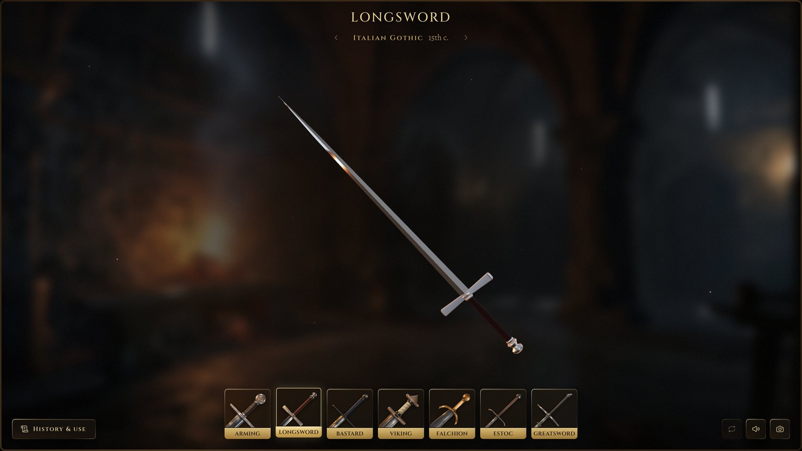

# Gustav's Forge



A 3D medieval sword configurator in the browser. Pick one of seven historical sword types and
rework it part by part (blade, guard, grip, pommel and finish) in a forge lit by its own fire.

**Live:** https://artskw.github.io/sword-forge-app/

## Highlights

- Seven sword types, from the Viking sword to the two-handed greatsword, each opening on a real,
  documented sword.
- Every option belongs to its period: parts from other ages are marked, with the reason why.
- Age the whole sword from fresh off the anvil to excavated: steel pits, brass darkens, leather rots.
- A history scroll for each sword: where it came from, how it was fought, its weight and balance.

## Built on museum sources

The swords follow real objects, not fantasy. About 180 museum pieces were studied, and the app
names the object behind each sword and part, with a link to the museum's page where there is one.
The most useful collections:

- [The Wallace Collection](https://www.wallacecollection.org/), London
- [The Cleveland Museum of Art](https://www.clevelandart.org/), open access
- [The Metropolitan Museum of Art](https://www.metmuseum.org/), open access
- [Kunsthistorisches Museum, Imperial Armoury](https://www.khm.at/), Vienna
- [Finnish Heritage Agency](https://www.museovirasto.fi/), for Viking-age finds
- [Portable Antiquities Scheme](https://finds.org.uk/), for excavated parts

Knightly blades follow Ewart Oakeshott's typology, and Viking hilts Jan Petersen's.

## Under the hood

React Three Fiber (three.js), React, TypeScript and Vite. No 3D models: every part is built in code.

- Blades are lofted ring by ring from their cross-sections; guards and pommels are turned and
  extruded from profiles.
- Steel grinds, wear and engraving are shaders, so a sword can age without a single texture swap.
- The light comes from the room in the background: the hearth on the left flickers with the fire
  in the video, and stays where it is on screen as the sword turns.

```
src/components/scene/   the sword in 3D: blade, guard, grip, pommel, the forge's light
src/components/forge/   the editor: type cards, inspector, history scroll
src/presets/            the catalogue: types, forms, parts and their museum sources
src/lib/                blade geometry, weight and balance, sound, the fire
```

```sh
npm install
npm run dev
```
